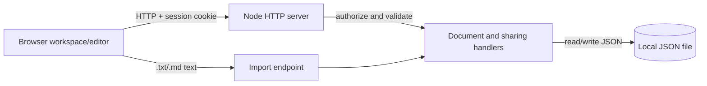

# Architecture

## Structure

- `server.js` — dependency-free Node HTTP server, JSON API, access checks, input validation, import conversion, and local data persistence.
- `public/index.html`, `public/app.js`, `public/styles.css` — responsive single-page editor and workspace UI.
- `test/server.test.js` — HTTP-level test for document privacy, sharing, viewer restrictions, and owner-only share management.
- `data/store.json` — created at runtime; ignored by Git.

## Authentication and sessions

The application exposes three seeded demo identities. A user selects an email on the sign-in screen; the server issues a random session cookie marked `HttpOnly` and `SameSite=Strict`, and adds `Secure` in production mode. The current implementation is explicitly demo-only: there is no password, external identity provider, rate limiting, or durable session store. Sessions are in memory and reset when the server restarts.

## Data model

Each document has an ID, title, sanitized HTML content, owner ID, a list of `{ userId, role }` shares, and ISO timestamps. Roles are `viewer` and `editor`. The owner is the only user allowed to grant or change shares. An editor may update title/content; a viewer may read. Document list queries return only owned or shared records. Unauthorized private document lookups return `404` to avoid disclosing existence.

## Editor storage and save behavior

The browser uses a native `contenteditable` surface and formatting toolbar. The server stores HTML with an allowlist of paragraph, heading, emphasis, list, quote, and line-break tags; all attributes and unsupported elements are removed. The client debounces updates and displays “Unsaved changes”, “Saving…”, “Saved”, or “Save failed”. The server writes the JSON store through a temporary file and rename. This design is simple for a single local process and is not safe for multiple server instances or concurrent writers.

## Import

The browser reads a selected `.txt` or `.md` file as text and submits it to `/api/import`. The server validates extension and a 1 MB byte limit, converts Markdown headings/lists/basic inline emphasis, escapes plain text, applies the HTML allowlist, and creates a new owned document. No uploaded file is retained.

## Deployment and environment

No hosted deployment is configured. `PORT` selects the HTTP port; `DATA_FILE` selects the JSON store path; `NODE_ENV=production` adds the Secure cookie attribute. A hosted deployment needs a persistent volume and a single writer process or a database migration. Ephemeral serverless storage is not suitable. See [DEPLOYMENT.md](DEPLOYMENT.md).

## Deliberate trade-offs and deferred work

- Used Node built-ins and browser APIs because the repository was empty; this avoids setup and package-install dependencies but produces a smaller editor than TipTap/ProseMirror.
- Used local JSON for a demonstrable persistent local workflow; hosted multi-user persistence needs a transactional database.
- Used passwordless seeded demo sign-in rather than real authentication. This must be replaced before any public deployment.
- Deferred deletion, comments, live collaboration, DOCX import, and public sharing to protect the core edit/share journey.
